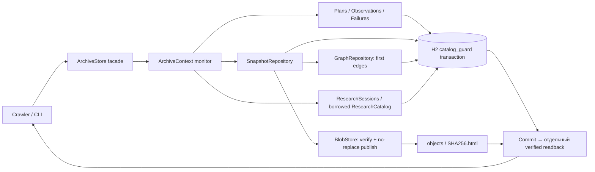

# Archive: modularization и concurrency hardening

Дата: 2026-11-14. Область: `src/main/java/dev/onionall/brawler/archive` и связанные
regression tests. Рабочие изменения владельца существовали до начала; сохранены.
Нет commit/push, изменений версий dependencies, schema version или Frontier authority.

## A. Контракт и архитектура до/после

**Outcome:** маленький стабильный ArchiveStore facade, явное владение persistence,
сохранённые данные/API и проверяемые failure outcomes. **Constraints:** core-v2,
JSON/cursors, approval/same-origin/Tor-only validation, все bounds и immutable snapshot
identity. **Evidence:** существующие regressions, новые controlled faults/concurrency
на настоящем H2 и итоговая сборка; внешний Tor/Docker acceptance отдельно.

Baseline прочитан целиком: ArchiveStore (1528 строк рабочего файла), ArchiveParseFilter,
оба status updaters, FailureObservation, SearchProvider и Kotlin ResearchCatalog.
Production callers: ArchiveCommands, CrawlService, JobStatusService, CrawlExecution,
WorkerLauncher, ArchiveParseFilter, ArchiveStatusUpdaterBolt, SearchProvider.LocalArchive;
capability updater использует общий recordOutcome. Test callers найдены в archive,
research, cli и admission. Build: Maven, Java/Kotlin target 25, H2 2.4.240,
JUnit 4.13.2/Surefire 3.6.0; Kotlin компилируется раньше Java.

Ранее один класс владел JDBC, DDL, URL validation, plans/approval, observation JSON,
transactions, objects directory, snapshot identity, graph, failures, search/export и
research bridge. Public instance monitor сериализовал callers одного store;
каждый store имел отдельный connection. Три ручных transaction paths использовали
`setAutoCommit(false) → catalog_guard FOR UPDATE → body → commit → restore`.
Plan create/approve работали в autocommit. ResearchCatalog имел собственный borrowed
connection monitor и savepoint-контракт. Shared mutable state: connection state,
SQL tables, filesystem; JSON maps возвращались detached, ObjectMapper не перенастраивался.

Теперь facade занимает 433 строки с Javadoc и содержит wiring и forwarding: JDBC и SQL в нём отсутствуют. Logical
package `internal` не является отдельным Maven module. Все public методы сохраняют
параметры, return types, overloads и `IOException`; public constants прежние.
Модификатор synchronized заменён context monitor; внешние callers не координировались
через monitor facade. Никакого ORM, DI framework или production dependency не добавлено.

### Инвентарь API и responsibility mapping

| API facade | Внутренний владелец | SQL boundary |
| --- | --- | --- |
| constructor / close | ArchiveContext + ArchiveSchema | DDL при open; serialized close |
| createPlan / approvePlan | PlanRepository | одна context transaction на mutation |
| plan / plans | PlanRepository | serialized autocommit reads |
| recordAdmission / recordJobStatus | ObservationRepository | одна context transaction |
| admissionObservation / hasExecutionHistory | ObservationRepository | serialized reads |
| job | ArchiveQueryService | составная serialized read projection |
| archive / importHtml | SnapshotRepository + BlobStore + GraphRepository | guard → blob → SQL commit; затем readback |
| pages / page | SnapshotRepository | metadata read / verified blob + history + links |
| links | GraphRepository | bounded historical query |
| search (оба overloads) / exportSummary | ArchiveQueryService | read-side filters до LIMIT |
| recordFailure (оба overloads) | FailureRepository | aggregate + event в одной transaction |
| failureHistory | FailureRepository | job-scoped through_sequence cursor |
| createResearchSession / updateResearchSession | ResearchSessions + ResearchCatalog | context transaction + borrowed savepoint/CAS |
| researchSession / researchSessionExists | ResearchSessions + ResearchCatalog | serialized reads |

## B. Компоненты

Все пути ниже относительно `src/main/java/dev/onionall/brawler/archive/`.

| Файл | Ключевые операции и ответственность | Зависимости / ownership |
| --- | --- | --- |
| `ArchiveStore.java` | прежний public API, forwarding | context + repositories; не получает connection |
| `internal/ArchiveContext.java` | read, transaction, capacity, close | единственный lifecycle connection; schema + ResearchCatalog |
| `internal/ArchiveSchema.java` | migrate | borrowed JDBC только при open; restart-idempotent DDL |
| `internal/ArchiveSupport.java` | normalize, identifier, bound, count | stateless validation, JSON mapper, authoritative field set |
| `internal/PlanRepository.java` | createPlan, plan, plans, approvePlan, approved | context + validation; specification/approval |
| `internal/ObservationRepository.java` | recordAdmission, recordJobStatus, admissionObservation | context + plans; bounded JSON/status audit |
| `internal/BlobStore.java` | hash, publish, verify | только objects path/bytes; не знает JDBC, plans или Frontier |
| `internal/SnapshotRepository.java` | archive, importHtml, page, pages | context + plans + blobs + graph; snapshot identity/versions |
| `internal/GraphRepository.java` | recordFirstLinks, readLinks, links | context + plans; immutable first-edge provenance |
| `internal/FailureRepository.java` | recordFailure, failureHistory | context + plans; aggregate и observation history |
| `internal/ArchiveQueryService.java` | job, search, exportSummary | context + plans/observations/snapshots/graph; projections |
| `internal/ResearchSessions.java` | четыре research bridge метода | context + заранее созданный borrowed ResearchCatalog |

Public видимость внутренних adapters нужна для facade через package boundary; это
implementation detail. Никто из них не хранит connection и не меняет autocommit.
Package-private connection access проверяет monitor ownership и open state.

## C. Concurrency и transaction model

Каждый facade call целиком выполняется внутри synchronized `context.read`;
`close` использует тот же monitor. Составной read не выпускает monitor между
локальными компонентами, research не обходит его. Разные store в одном JVM имеют
разные connections; H2 catalog_guard сериализует составные mutations и capacity scan.
AUTO_SERVER=FALSE, WRITE_DELAY=0, DB_CLOSE_ON_EXIT=FALSE сохранены; межпроцессный
сервер/многопроцессный доступ не вводился.

Context начинает transaction, получает guard, выполняет body, commit и restore.
Body IOException/SQLException/RuntimeException/Error вызывает rollback. Cleanup
ошибки suppressed; rollback failure не включает autocommit и выводит connection
из эксплуатации. Commit throw означает **UNKNOWN**, даже если cleanup rollback
прошёл. Успешный commit с ошибкой восстановления/response означает **COMMITTED**.
После quarantine новые операции отклоняются до JDBC. Неудачный close допускает
повторное освобождение ресурса, успешный close идемпотентен. Nested transaction и
reentrant close из transaction отклоняются.

Порядок: context monitor → JDBC begin → H2 guard → filesystem publication **либо**
ResearchCatalog connection monitor → savepoint/тот же guard. Research reads:
context monitor → connection monitor → JDBC. Adapter не получает context обратно,
connection не выдаётся наружу, обратного lock path нет. Schema и research DDL
выполняются при open до transaction; ResearchCatalog внутри mutation не коммитит
внешнюю transaction и не меняет её autocommit. Его standalone API не переписывался.

Loom отложен: Java 25 поддерживает virtual threads, но они не разрешают concurrent
JDBC access. Bounded archive не имеет подтверждённой задачи scheduler/thread scaling;
без workload evidence смена примитива не улучшает correctness.

## D. Подтверждённые дефекты и решения

| Concern | Исходное поведение / риск | Решение и regression evidence |
| --- | --- | --- |
| ARCH-001 | Replay одинакового page/hash/source_kind отбрасывает новые edge observations | Сохранён явный существующий first-snapshot contract: исходный graph regression требует первые edges неизменными. Это не discovery-event log. Отдельная bounded history/refetch provenance требует согласованного data/retention contract; silent append нарушил бы immutable semantics и прежний bound. Deferred, schema не менялась |
| ARCH-002 | job.putAll позволял plan_id/provider/created_at и legacy JSON подменять specification | Общий authoritative field set, write validation, read-side filter для legacy; matching plan_id разрешён worker. State/admission/status сохранены. ArchiveAuthorityTest: исходно 4 failures из 5, после fix всё проходит |
| ARCH-003 | page readback IOException после commit попадала в rollback handler | Transaction возвращает только page id; readback отдельно с явным COMMITTED message. SnapshotPersistenceTest: реальный H2 + proxy fault для first write и dedup, rollback=0, reopen/replay и один snapshot |
| ARCH-004 | ATOMIC_MOVE не гарантирует no-replace | Force + digest-verified temp → Files.createLink destination → cleanup. Existing winner проверяется, конфликт не перезаписывается. BlobStoreTest: simultaneous equal writers и conflicting creation с тем же размером |

Также исправлены: unchecked body failure не может включить autocommit и сохранить
частичную запись; cleanup не маскирует primary; HTML defensive copy после size check;
null maps/JSON/link observations дают IOException; missing blob может быть восстановлен
проверенным replay, corrupt existing blob не заменяется и latest/last_seen не коммитятся.
Cancellation проверяется до открытия snapshot transaction.

SQL schema statements перенесены без изменения; core version=2 и additive extensions
совместимы с существующим каталогом. Migration regression восстанавливает старые
page_links clocks и проверяет повторное открытие. Snapshot dedup и manual source kind
сохранены. Link resolution остаётся within job; host filtering выполняется до LIMIT.

## E. Проверки

Окружение: OpenJDK 25.0.5, host Maven, существующий checkout-local cache. Network
external не использовалась; полный verify получил разрешение на local loopback.
Kotlin daemon отключён, чтобы compiler не писал за пределами доступных каталогов.

Команды выполнялись из `/home/callesnikov/Projects/onionall-brawler`:

```sh
# Исходная regression ARCH-002: 5 tests, 4 ожидаемых failures, 0 errors/skips.
mvn -o -Dkotlin.compiler.daemon=false -Dmaven.repo.local=.runtime/maven-linux-repository -Dtest=ArchiveAuthorityTest test

# Extraction gate: финально 71 tests, 0 failures/errors/skips, BUILD SUCCESS.
mvn -B -o -Dkotlin.compiler.daemon=false -Dmaven.repo.local=.runtime/maven-linux-repository -Dtest='dev.onionall.brawler.archive.**,ResearchCatalogTest,ResearchWorkflowConcurrencyTest,ResearchThreadsTest' test

# Full root build, unit/integration tests, JAR + shade: BUILD SUCCESS.
mvn -B -o -Dkotlin.compiler.daemon=false -Dmaven.repo.local=.runtime/maven-linux-repository verify

# После full verify добавлены host-filter и partial-restart cases:
# 7 tests, 0 failures/errors/skips, BUILD SUCCESS.
mvn -B -o -Dkotlin.compiler.daemon=false -Dmaven.repo.local=.runtime/maven-linux-repository -Dtest=ArchiveConcurrencyTest,SnapshotPersistenceTest test

# Whitespace и local Markdown links: PASS.
git diff --check
python -B scripts/runners/verify.py --links-only

# Classpath для JDK Javadoc validation: BUILD SUCCESS.
mvn -B -o -Dkotlin.compiler.daemon=false -Dmaven.repo.local=.runtime/maven-linux-repository dependency:build-classpath -Dmdep.outputFile=/tmp/archive-classpath.txt
```

Полный verify выполнил **369 tests, 0 failures, 0 errors, 0 skipped** и собрал
root shaded artifact. Последующий targeted run включает два новых cases, поэтому
совокупно проверено 371 различных tests; полный набор после их добавления заново
не запускался. Последующие production edits касались только Javadoc/import cleanup.

Также выполнен JDK `javadoc -quiet -Xdoclint:all -package -encoding UTF-8` для
ArchiveStore и всех internal sources, с `target/classes` и полученным dependency
classpath, output `/tmp/archive-javadoc`. Результат: exit 0, без warnings/errors.

Неуспешные промежуточные проверки не скрыты:

- Первый Maven без `-Dkotlin.compiler.daemon=false` остановился до tests на read-only
  daemon marker в home. Начальный baseline store/history/research не выполнялся.
- Combined extraction gate сначала выявил IOException declaration у GraphRepository;
  после исправления 44 tests нашли отмену, проверявшуюся слишком поздно. Исправлено
  до зелёных gates, assertions не ослаблялись.
- Расширенный selected run `-Dtest='dev.onionall.brawler.archive.**,ResearchCatalogTest,ResearchWorkflowConcurrencyTest,ResearchThreadsTest,ArchiveCommandsTest,JobStatusIntegrationTest'`
  выполнил 81 test с 3 errors: socket creation запрещён окружением. После разрешения
  loopback те же интеграции прошли в full verify.
- Link checker сначала выявил неверный относительный путь нового report; исправлен,
  затем PASS. Финальный evidence: `.runtime/verification/run-fzu7lsq8/result.json`.

Логи: `/tmp/archive-authority-baseline.log`, `/tmp/archive-focused-final.log`,
`/tmp/archive-verify.log`, `/tmp/archive-final-regressions.log`,
`/tmp/archive-javadoc.log`. Surefire reports находятся в `target/surefire-reports`.

Отдельная проверка сравнила 26 public signatures без synchronized/whitespace,
19 schema statements и 6 прежних несвязанных worktree diffs: всё сохранено.
Независимый read-only review охватил итоговые компоненты, facade, tests, CLI
recursive packaging и документацию; найденная close-retry проблема исправлена.
Scoped inspection новых source/docs не обнаружил secrets или diagnostic HTML dumps.

Не запускались Docker synthetic archive graph, отдельный Frontier project verify,
packaged CLI distribution build, real Tor crawl, real provider и power-loss tests.
Existing ArchivePipelineTest/ParserArchiveAckCharacterizationTest являются JVM
pipeline tests, не доказательством полного внешнего crawler acceptance.

## F. Ограничения и эксплуатационные риски

- Hard-link publication требует поддерживающей filesystem. Unsupported операция
  завершается ошибкой без overwrite fallback; SQL откатывается, данные не удаляются.
- File force и publication не являются directory-fsync/power-loss доказательством.
  Гарантия рассчитана на поддерживаемую local process/restart модель и storage,
  сохраняющее успешно опубликованные объекты; внешнее удаление/порча обнаруживаются.
- SQL rollback/crash может оставить complete orphan или private temp. Они учитываются
  capacity scan консервативно. Recovery/GC protocol не придуман, cleanup не добавлен.
- Symlink checks не устраняют все TOCTOU attacks внешнего writer. Storage directory
  должен принадлежать доверенному оператору. Совместные writers координируются H2.
- Read projections между разными connections не являются frozen SQL snapshot;
  historical link observations описывают первое сохранение версии, не все refetches.
- Standalone ResearchCatalog имеет прежние error/cleanup semantics. Через Archive
  outer coordinator обеспечивает rollback/quarantine и единое владение connection.
- Полный Tor crawl, provider availability, Docker lifecycle и power-loss crash test
  этим рефакторингом не квалифицируются.

## G. Модель потока



HTML сначала проверяется по approval/scope/budgets, копируется и получает digest.
Под guard публикуется полный объект; H2 сохраняет metadata/edges и latest pointer.
Context подтверждает commit, затем page читает metadata и проверяет blob. Ошибка
ответа после commit не отменяет persistence. Parser emission остаётся после возврата
archive; Frontier сохраняет scheduling authority и отдельную at-least-once границу.
