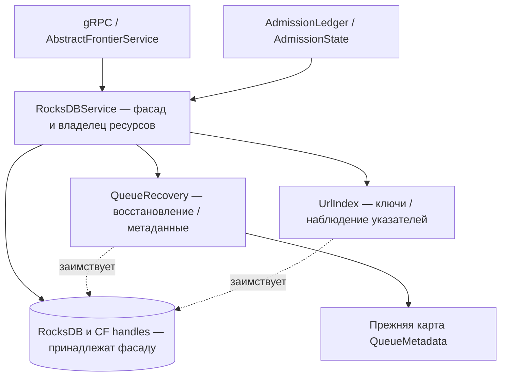

# Декомпозиция RocksDBService

Дата: 2026-11-15, Europe/Istanbul. База: `b3650f7` из
`feature/m61-forum-research`, включающая M6 `af0504a`.
PR #7 при проверке открыт, не слит. Работа ведётся в отдельной ветке
`refactor/frontier-rocksdb-decomposition`; подготовленные изменения исходного
рабочего каталога не включены и не перезаписаны.

## Структура и границы

До: AdmissionLedger, AdmissionRpc, AdmissionState, QueueMetadata,
RocksDBService, ShardedRocksDBService и AGENTS.md в прежнем пакете
`crawlercommons.urlfrontier.service.rocksdb`.

После: те же компоненты плюс **package-private final QueueRecovery и UrlIndex**.
Существующие компоненты не переименованы и не перемещены.

Подпакет internal намеренно не добавлен: Java не предоставляет ему доступ
к package-private типам исходного пакета. Два связанных компонента остаются
скрытыми в прежнем пакете. Это исключает публичный мост и расширение API ради
размещения файлов. Универсальный контекст, новый Maven-модуль, зависимости,
DI-контейнер и новые интерфейсы не нужны.



Это схема обязанностей и владения; пунктир не обозначает дополнительное
хранилище или транзакцию. AdmissionLedger по-прежнему использует ту же базу
и общий WriteBatch. Декомпозиция не меняет полномочия Admission.

**QueueRecovery:** перенесены recovery → recover, recoveryQscan → scan,
readQueueInfos и writeQueueInfos. Получает только базу, три существующих
CF handles и карту очередей. Сканирует до публикации службы, сохраняет
метаданные во время прежней остановки. Локальные RocksIterator закрываются
в прежних try-with-resources; базу и CF не закрывает. Проверки совпадения
счётчиков, порядок обхода и формат двух int сохранены.

**UrlIndex:** перенесено тело schedulingObservation → observe и общее
кодирование scheduling keys из putLegacyURLItem/stageAdmission. Получает
базу и только default/queues handles. Нормализация очереди, UTF-8, разделители,
DecimalFormat и даты сохранены. observe не выдаёт URL и не изменяет leases;
вызывающий держит прежние admissionLock и monitor очереди.

Применены Facade, композиция, делегирование и передача зависимостей через
конструкторы. Strategy не нужна: взаимозаменяемых алгоритмов здесь нет.

## Что осталось в фасаде

- Конструкторы и close: владение RocksDB, Statistics, CF handles и остановкой.
- putURLItem/putLegacyURLItem: admissionLock → interned URL monitor, прежний
  WriteBatch, обновление счётчиков после записи.
- stageAdmission/publishAdmission/admissionCommand: общий Admission batch
  дополняется в AdmissionLedger, commit и публикация счётчиков не разделены.
- sendURLsForQueue: выдача, per-queue ограничения и прежние leases.
- deleteQueue/deleteLocalQueue/deleteCrawl/deleteLocalCrawl/deleteRanges:
  общая карта, отметки удаления и различающиеся monitor boundaries. Унаследованные
  range deletes не объявляются новой атомарной транзакцией.
- getURLStatus: сохранены RPC observer/error semantics, включая отдельно
  отмеченную старую проблему продолжения после onError.
- urlIterator/RocksDBURLItemIterator: Iterator не предоставляет closeable
  контракт, а AbstractFrontierService может остановить обход по лимиту.
  Перенос без отдельного решения владения нативным итератором лишь скрыл бы дефект.
- schedulingObservation оставлен как прежняя package-private точка делегирования.
  Внешние public/protected объявления и ShardedRocksDBService не менялись.

Исходный файл в **согласованной базе** содержит 1089 строк, итоговый — 1005.
В исходном рабочем каталоге было 1094 строки из-за его подготовленных правок;
они не входят в эту ветку. Перенос логики частично компенсирован подробной
русской документацией. Количество строк не является критерием безопасности.

## Проверка

Среда: OpenJDK 25.0.5, Maven, прежний SHA-pinned URLFrontier 2.4 baseline
`ff1b774bf81343234e6f34878f8b7c9a826371b3e305e96bf0e204895e3562df`.
Использован существующий локальный Maven cache; версии и build scripts не менялись.

Команда для baseline, каждого извлечения и итогового исходного текста:

```sh
mvn -B -o -f frontier-server/pom.xml \
  -Dmaven.repo.local=/path/to/existing/maven-cache verify
```

Baseline, QueueRecovery и UrlIndex: BUILD SUCCESS, все семь suites PASS:
AdmissionConformance, AdmissionMigrationConformance, AdmissionShutdownConformance,
AdmissionRpcConformance, RecoveryCountersConformance, AdmissionStateConformance,
AdmissionAmbiguousRpcConformance. Это реальные изолированные RocksDB базы,
loopback gRPC, чистые перезапуски и отдельный процесс с аварийным halt.

Итог после документирования: Frontier verify BUILD SUCCESS, семь suites PASS;
server JAR SHA-256 `de3de5db31cec820b15a3866282081b7a43c9b9191a35b92d4366c758b3761e9`.
Полный `mvn -B -o -f crawler/pom.xml -Dkotlin.compiler.daemon=false
-Dmaven.repo.local=/path/to/existing/maven-cache verify`: **340 tests PASS,
0 failures/errors/skips**, BUILD SUCCESS. Сборка использует существующий shade
pipeline с его прежними предупреждениями о пересекающихся resources/classes.

Первый baseline запуск остановился на запрете локального socket; после разрешения
loopback повтор прошёл. Это ограничение среды, а не подавленный assertion.

RocksDbDecompositionChecks подключён к существующему RecoveryCountersConformance,
поэтому выполняется и из Maven, и из build.sh без отдельного test runner.
Проверяет независимые исходные bytes ключей (включая подчёркивания и будущую дату),
metadata bytes, чтение сохранённых счётчиков, смешанные scheduled/unscheduled rows,
отклонение несогласованного указателя и сохранение работоспособности borrowed DB.

Отдельно **PASS**: копия базы, созданной baseline до рефакторинга, открыта новым
бинарным файлом; проверены счётчики, due membership, readback и quota-idempotent replay.
Baseline база и пользовательские базы не изменялись; использована отдельная копия.

Существующие suites проверяют конкурентные reservation calls, гонку Admission
со shutdown, задержанные RPC commits и чтение при изменении состояния. Это не
доказательство безопасности произвольного конкурентного удаления или прекращения
всех пользовательских iterators. Новые format/recovery проверки последовательные.

Независимый review: пять перенесённых тел совпали по Java-токенам после замены
получателей/CF aliases. Public/protected объявления и порядок locks/commit/close
сохранены. Assertions не ослаблены. git diff --check PASS.

Graphify использован до выбора границ (существующий граф) и для текущего Frontier:
19 файлов, 412 узлов, 1090 связей; новые зависимости фасада на QueueRecovery/UrlIndex.
Владение нативными ресурсами и блокировками дополнительно проверено по коду:
AST-граф сам по себе не доказывает эти свойства. Известные неточности общих
имён в исходном полном графе не использовались как доказательство вызовов.

## Сохранённые ограничения и следующие границы

Точные TODO у исходных участков, без функциональных исправлений:

- INIT-001: освобождение ресурсов при неполной инициализации.
- STATUS-001: продолжение после onError в ветке повреждённого protobuf.
- ITERATOR-001/002: владение RocksIterator и key() после выхода за конец.
- DELETE-001/002: конкурентные отметки удаления и раздельные range deletes.
- RECOVERY-001/002: dormant check=false active и полуоткрытая очистка queueInfos.
- IDX-001: static DecimalFormat между экземплярами службы с разными locks.

Это унаследованные участки, установленные по коду; опасные corruption/native
сценарии здесь не запускались ради воспроизведения. Они не исправлены и не
объявлены новыми регрессиями. Отдельные будущие задачи требуют characterization
и согласования соответствующего resource/concurrency контракта.

Наблюдаемое отличие: сообщения перенесённого recovery теперь имеют logger category
QueueRecovery. Текст сообщений, RPC и данные сохранены; source line numbers также
закономерно изменились. Полная идентичность debug/log metadata не обещается.

Живые Tor-запросы, пользовательские базы, миграции, main и существующие feature PR
не изменялись. Контейнерная приёмка и hosted CI учитываются отдельно от локальных
проверок; отсутствие доступа к Docker socket не является продуктовым PASS.

## Доставка и ограничения среды

Ветка создана локально от b3650f7. Все изменения остаются в изолированном worktree;
коммитов и нового PR пока нет. Планируемая база PR — feature/m61-forum-research,
а не main, поэтому diff не будет включать M6/M6.1 повторно.

Автоматическая проверка отклонила две операции до исполнения:

1. Создание GitHub tree с изменёнными исходниками/тестами в
   CallesnikovProduction/onionall-github-mirror: сочла внешнюю публикацию
   недостаточно явно разрешённой.
2. Создание локального коммита: сочла создание коммита не запрошенным.

Обе операции прямо предусмотрены разделом 13 приложенного задания, но запреты
не обходились. Для продолжения требуется явное подтверждение владельца локальных
коммитов и PR в названном репозитории. SSH отдельно недоступен; GitHub connector
читает нужный репозиторий, а получение Git refs по HTTPS работает.
Hosted CI не запущен, ссылки на новый PR нет. Готовое описание PR и полный patch
сохранены локально рядом с журналами в .runtime данного worktree.
