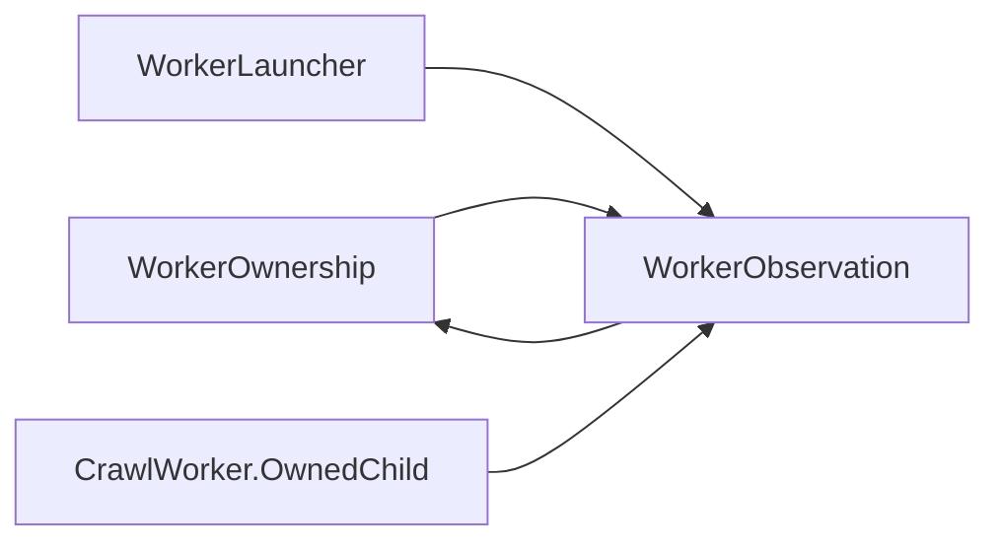
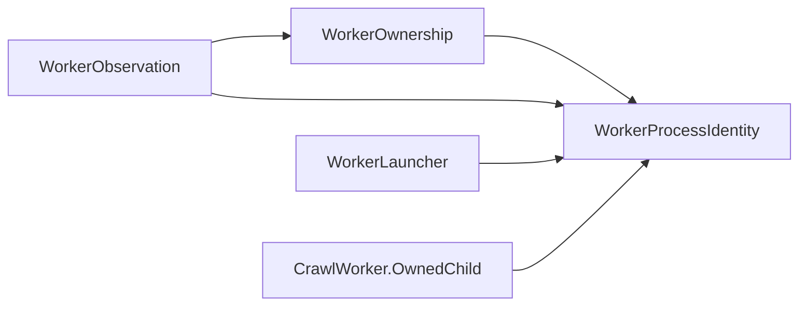

# M4.1 durable admission execution ledger

Baseline: migration/java25-storm31 at 5f7f9da; clean worktree.
06c6366 Recovery and 5be5763 Archive MVP are present. No push authorized.

## Checkpoint 1 — contract

Implement admission in the existing Frontier owning RocksDB boundary: immutable
approved session, canonical same-origin URLs, parent-derived depth, serialized
quota check and one sync WAL WriteBatch containing reservation+counter+enqueue.
Publish scheduling index changes only after commit. H2 records observations,
never pending jobs or authoritative budget. RPC replay uses plan/session+URL.
Fresh isolated databases only; never migrate user volumes. Added admission CF
requires candidate-compatible rollback; stock2.4 cannot reopen it.

Implementation and conformance in progress; no admission/CLI/E2E PASS claimed.
Existing Recovery and real-Tor M2/M3 qualification are independent.

## Checkpoint 2 — authoritative server primitive verified

Versioned candidate source/build is under frontier-server/. Actual owning RocksDB
conformance passed:64 concurrent requests/quota10, duplicate/reopen, prewrite
failure without index mutation, source/scope/extension/seal guards, subprocess
halt before commit and after sync-WAL-before-ACK. Explicit isolated-copy schema
upgrade preserves legacy data; stock rollback refuses4CF, compatible readonly
rollback retains protection. Real loopback gRPC capability/admin/read tests pass.
Evidence: frontier-server/target/build.EyF8AC/{conformance,migration,rpc}.log.
Application offline build115 tests PASS in /tmp/m41-build-3.log. Python Recovery113,
packagedCLI16 and archivefixture2 PASS. Full M4.1 E2E NOT yet verified.

First runner attempt b75c0f53d0de failed before infrastructure (Path.open opener
argument); corrected to builtin open with mode600. Second d9c3c39d3fdb committed
seed admission/readback but Storm launch failed: daemon log path remained the
read-only /apache-storm/logs. Need daemon -c options, not topology-only config.
Failed evidence retained; cleanup/volume/host checks pass. No live Tor used.

## Checkpoint 3 — CLI, archive reconciliation and graph integration

Implemented AdmissionClient, bounded foreground CrawlExecution and child-owned
archive-wide CrawlWorker ownership/deadline. The initiating CLI can be killed
without releasing the running child's lock. H2 is closed before worker launch.
Unknown catalog outcome reconciles by authoritative readback of the same session,
not reseeding or allocating a new budget. Graph schemaV2 adds first-observation
time and dynamic same-job target-page resolution; rejected foreign links retain
identity without admission. Archive is still not a scheduling queue.

Failed95e1e6db73f7 exposed classpath-only filter loading: generated absolute files
were not worker resources. CrawlResources now publishes a job-specific full JAR
with classpath resources before admission; original installed artifact unchanged.
The nextfc01e857551a run fetched/archived A/B/C, retried503 and preserved quota
through recreation, but correctly failed Robots refusal not observable: runtime
metadata.persist omitted error.cause/source. Corrected those keys; no gate relaxed.

Final app build: .runtime/m41-build-final.log,118 JVM tests PASS, no skips/errors.
Packaged CLI17 (including real RPC dependency/failclosed smoke), Recovery Python113
and archivefixture2 pass in .runtime/m41-python-*-final.log.

Independent review fixed .onion RPC endpoint direct-DNS possibility and native
storage close vs active admission race. Server stopping is visible before drain;
late commands reject, active commit finishes before native handles close. Real
latched shutdown/reopen regression passes alongside concurrency/crash/migration/
auth in frontier-server/target/build.P98g1K/.

Actual Recovery regression running separately: .runtime/m41-recovery-regression.log.
Final M4.1 E2E running: .runtime/m41-e2e-final.log. Do not infer either PASS yet.
Original /tmp driver logs disappeared across the user's environment refresh;
continuation evidence is now saved under persistent ignored .runtime/. All earlier
per-project runtime evidence remains retained. User .gitignore edit is unrelated.

## Checkpoint 4 — actual vertical and Recovery verified

Final controlled project f175c5834c79 PASS. Source of truth:
.runtime/m2/onionall-brawler-m2-f175c5834c79/admission-local.json and
.runtime/m41-e2e-final.log. Actual CLI entrypoint starts Storm/TorProtocol against
real candidate Frontier: approval rejection,4 reservations,3 snapshots,8 directed
edges, foreign/depth rejection, robots terminal reason,503 scheduled retry, worker
and server restart, stable seed identity and repeated start without quota change.
Containers/networks removed, fresh Frontier volume retained, host snapshots equal.

Actual Recovery7d7260899b6d PASS: pending-before-outage, persisted error, stored-date
retry and terminal characterization, cleanup/retention/host equality. Evidence:
.runtime/m2/onionall-brawler-m2-7d7260899b6d/deterministic-recovery.json and
.runtime/m41-recovery-regression.log. M2/M3 qualification flags remain false.

The final packaging-specific pass mounts target/onionall read-only into the
controlled crawler and uses its actual bin/onionall for start/status. It is in
progress in .runtime/m41-e2e-packaged.log; this extra pass checks the thin runtime
closure rather than using the broader fat JAR classpath.

## Checkpoint 5 — packaged CLI acceptance complete

Project a7c09e2448f4 PASS via the actual read-only packaged /cli/bin/onionall
inside the crawler namespace, including start/status. Evidence:
.runtime/m2/onionall-brawler-m2-a7c09e2448f4/admission-local.json and
.runtime/m41-e2e-packaged.log. packaged_cli_verified=true, durable_admission_verified
=true;4 reservations,3 actual archived pages,8 graph edges.503 stored-date retry,
worker/server restart, stable reservation identity, repeated start, archive reopen
and CLI search/export all pass. Containers/networks removed, volume retained,
host snapshots equal. No external Tor was started; m2_verified/m3_verified=false.

Final sources passed118 JVM tests (.runtime/m41-build-final.log), server realDB
concurrency/crash/migration/RPC/shutdown conformance (build.P98g1K), packaged CLI17,
Python Recovery113, archivefixture2 and actual Recovery7d7260899b6d. Independent
review found no quota/replay bypass; its endpoint/shutdown findings were fixed.
No existing user RocksDB volume was migrated; no evidence or volume was deleted.
The user's .gitignore assets/ edit is intentionally excluded from local commits.
No push is authorized or performed.

Local checkpoints:842081d (server primitive),e95d4f4 (shutdown/canonical identity),
2f2e819 (verified CLI/archive integration). Final file-mode review caught staging
copy removing the public build script executable bit; restored and checked with
test -x. User .gitignore remains the only unrelated worktree change. No push.

## 2026-11-28 — архитектура Admission: независимая идентичность процессов

Исходная точка: чистая `main`, HEAD `2e42d22`. Область — пакет `admission`,
его существующие JVM-тесты и один Kotlin-компонент того же пакета. Пользователь
разрешил локальный commit всех изменений и запретил push.

**Outcome:** отделить проверку идентичности процессов от представления статуса.
**Constraints:** сохранить API, nullable-наблюдения, ownership journal v1,
startup/handoff/cleanup, Windows/Linux-пути, Frontier authority и capability.
**Evidence:** characterization до переноса, process/crash regressions, native Maven
build, сравнение `javap` и свежих зависимостей bytecode.

### Наблюдаемая карта ответственности

| Контур | Владельцы и связи |
| --- | --- |
| Admission | `CrawlAdmissionService` → `AdmissionClient` / `FrontierReadback`; резервирование и квота остаются на сервере |
| Discovery | `DurableDiscoveryFilter` → RPC/readback, TorPolicy и ForumPagination; собственные bounds и provenance |
| Исполнение | `CrawlExecution` → runtime preparation → admission → WorkerLauncher/CrawlWorker; WorkerOwnership хранит локальный cleanup proof |
| Статус | `WorkerObservation` читает ownership/execution; JobStatus/JobStatusView оценивают и представляют наблюдения; reconciliation принадлежит crawl.JobStatusService |

Проверены callers из worker/ownership/status, tests и `test/admission/WorkerOwnershipProbe.java`,
reflective entrypoints, generated topology/resources и состав thin CLI.
Существующий Graphify snapshot `31ce1d7` использован как навигатор, затем связи
проверены по исходникам и свежему bytecode. Это старый snapshot, не доказательство
текущей структуры; граф не перестраивался, новая LLM extraction не запускалась.

### Finding и выбранное исправление

**ADMISSION-ARCH-001, medium, TANGLE (architectural judgment):**
`WorkerOwnership` и его Preparation зависели от `WorkerObservation.scope/start/alive`,
а `WorkerObservation.read` зависел от WorkerOwnership.read/stopped.
ArchUnit подтвердил оба направления в baseline bytecode. Низкоуровневая проверка
PID/start instant/scope находилась в компоненте, который также читает execution,
собирает диагностическую Map и создаёт JobStatus.Worker. Изменение представления
статуса затрагивало класс, от которого зависел безопасный запуск.

Сохранение структуры оставляло эту связь. Перенос всего запуска в другой пакет
затронул бы package-private callers и entrypoints без необходимой пользы.
Минимальное исправление — общий `WorkerProcessIdentity`, не читающий журнал,
не формирующий JobStatus и не посылающий сигналы. Новый компонент написан на Kotlin
согласно корневым инструкциям; он не зависит от Java-исходников приложения.
Остальной корректный Java-код сохранён.

До:

После:

WorkerObservation.scope/start/alive оставлены совместимыми forwarding API для
tests/probes. Проверки в новом владельце сохраняют допустимые Integer/Long PID,
точный start instant, исходный SHA256 scope и три состояния true/false/null.
Неизвестная идентичность не становится доказательством остановки. Проверка,
способная опровергнуть исправление: malformed/reused/dead PID characterization,
hard-crash с живым child и запрет restart до admission, cleanup и handoff tests.

Другие наблюдения не объявлены устранёнными: пакет по-прежнему объединяет несколько
контуров; `admission ↔ crawl` и связи через archive/adapters сохранены. Общий JSON writer
пока принадлежит CrawlRuntimePreparer. Эти связи не оправдывают автоматический
перенос стабильных API в данном изменении. Похожие recovery-пути seed admission и
discovery не объединялись: у discovery есть page deadline и first-provenance semantics.
PMD-метрики сложности строгих RPC/JAR/discovery validators сами по себе не доказывают
нарушение архитектуры. EXEC-002, RPC-001 и terminal provenance остаются отдельными
неизменёнными контрактными задачами.

### Проверка и границы доказательств

Окружение: Windows 11 amd64, Python 3.12.10, JetBrains JDK 25.0.5.1,
Maven 3.10.0, Kotlin 2.3.21/JVM target 25; версии проекта не менялись.
Первый offline baseline с `.runtime/maven-repository` остановился на отсутствующем
coroutines artifact. Default user cache был недоступен для lock writes в sandbox.
Существующий `.runtime/maven-linux-repository` содержит необходимые portable Maven
artifacts. Sandbox запрещал локальные Kotlin daemon sockets; последующие Maven
запуски выполнялись с разрешёнными loopback/process fixtures. Ничего не устанавливалось
в систему; внешние onion-сервисы не вызывались.

Для команд ниже JDK 25 выбран через JAVA_HOME/PATH; Maven repository аргумент:
`-Dmaven.repo.local=.runtime/maven-linux-repository`.

| Gate / команда | Реальный результат |
| --- | --- |
| Baseline `mvn -B -o -Dtest=dev.onionall.brawler.admission.*Test test` | PASS: 119 tests, 0 failures/errors, 6 skips |
| До переноса `mvn -B -o -Dtest=WorkerObservationTest test` | PASS: 6 tests, 0 skips; включены 3 новые characterization cases |
| После переноса `mvn -B -o -Dtest=WorkerObservationTest,WorkerOwnershipTest,CrawlWorkerTest,CrawlExecutionCleanupTest,WorkerCrashCharacterizationTest test` | PASS: 21 tests, 0 failures/errors/skips |
| Первый полный `mvn -B -o verify` | FAIL: 469 tests, 1 failure, 11 skips; unchanged CapabilityReliabilityTest.interruptedPermitWaitFailsOnceAndPreservesInterrupt |
| Диагностический `mvn -B -o -Dtest=CapabilityReliabilityTest surefire:test` | PASS: 9 tests, 0 failures/errors/skips; assertions не менялись |
| Повторный полный `mvn -B -o verify` | PASS: 469 tests, 0 failures/errors, 11 skips; compilation, native library build и shaded JAR packaging завершены |
| Admission в итоговом полном прогоне | 122 tests, 0 failures/errors, те же 6 platform skips |
| `javap -public` существующих 15 Java-классов Admission до/после | PASS: текст сигнатур совпадает; прежние forwarding API сохранены |
| Состав нового shaded JAR | PASS: WorkerProcessIdentity.class присутствует; thin CLI build script копирует весь admission package и Kotlin stdlib |
| `git diff --check`, strict UTF-8 и scoped secret-signature check | PASS; raw logs, generated files и JSON анализатора не включены в commit |

Одна промежуточная компиляция остановилась на недоступном Kotlin-вызове Java
String.strip; заменён эквивалентным trim с Character.isWhitespace. Последующие
фокусный и полный build прошли. У semaphore-теста await сначала проверяет
hasQueuedThreads в цикле, затем повторяет проверку в assert; timed acquire может
покинуть очередь между чтениями. Это объяснение наблюдаемой нестабильности,
а не доказанное исправление теста: адаптер и его тест оставлены без изменений.
Первое падение сохранено в `.runtime/admission-refactor/verify-after.log` и
`verify-first-reports/`; успешный прогон — `verify-final.log`.

Обязательный doctor выполнился; bootstrap PMD 7.29.0 и ArchUnit 1.4.2 прошёл
offline smoke-tests из уже установленного skill cache. Первый sandbox bootstrap
без результата был остановлен; успешный offline bootstrap выполнен отдельно.
Анализ и verify использовали одинаковые engines/rules/scope, JDK 25 и явный
`--classes target/classes`. Baseline — 232 типа после успешной исходной сборки,
current — 234 после итогового compile. Оба анализатора completed, конфигурации
совпали; verify прочитал 81 актуальный JUnit report (469 tests).

Проверка raw bytecode edges подтвердила удаление Ownership → Observation и
сохранение Observation → Ownership. Все четыре потребителя (Ownership, Observation,
Launcher, OwnedChild) используют WorkerProcessIdentity; у identity-компонента нет
исходящих зависимостей на другие классы приложения. Общий пакетный граф не объявлен
ацикличным. Это доказательство конкретного исправления, не снижение общего score.

Coverage: ArchUnit — compiled JVM dependencies; PMD — Java design heuristics без
project auxiliary classpath и Java/Kotlin CPD с порогом 60 tokens. Kotlin-компонент
проверен compiler, тестами и bytecode; отдельные Detekt/Konsist/jQAssistant не
выбирались для этой локальной задачи. Source inventory анализатора также включает
три retained `.runtime/native-integrity` копии исходников. Все 41 итоговое CPD
сообщение в scope содержит такие копии и отклонено как самостоятельное доказательство
production duplication. Уменьшение Java complexity flags 32 → 31 после переноса
в Kotlin также не используется как доказательство улучшения.

Полные локальные отчёты вне репозитория: `%TEMP%/admission-deslop-baseline.json`,
`admission-deslop-current.json`, `admission-deslop-agent-findings.json`.
Команды tool: `jvm_deslop.py analyze/verify . --engine pmd --engine archunit
--classes target/classes --scope src/main/java/dev/onionall/brawler/admission
--scope src/main/kotlin/dev/onionall/brawler/admission --offline`, с явными
`--java-home`, `--output`; verify добавляет baseline и `--junit target/surefire-reports`.
Graphify token cost: 0 для новой extraction; использован только локальный snapshot.

11 пропусков относятся к symlink/POSIX/ACL-возможностям платформы; это не успешные
проверки этих сценариев. Linux process scope, Docker/Storm end-to-end и real Tor
заново не запускались. Frontier server не изменялся и отдельно не пересобирался.
Существующий hard-crash case по-прежнему демонстрирует предел JVM containment;
его прохождение доказывает сохранённый restart guard, а не устранение REC-09.
